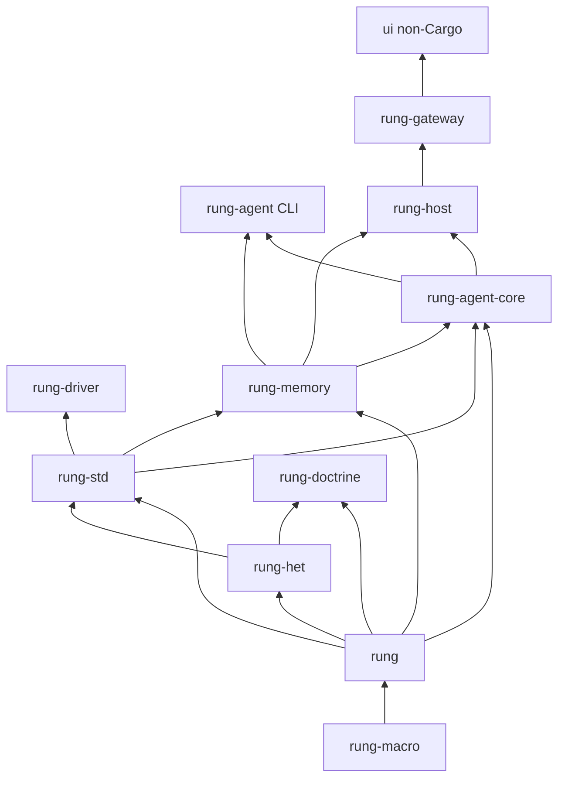

# Workspace Architecture and Ownership Boundaries

Rung is one Cargo workspace, but it is not one product. Its reusable kernel provides a type-state language and generic building blocks; the product side composes those facilities into an agent, persistent memory, a continuous host, and an HTTP gateway. The browser UI, repository scripts, examples, and documentation are adjacent deliverables rather than Cargo crates.

The central placement rule is: **put a recurring, domain-generic mechanism in the kernel; put catalogs, sessions, credentials, process lifecycle, host state, and deployment-facing behavior in a product crate.** In particular, do not move a product concern into `rung-std` merely because multiple product components use it.

## Workspace map

This is the production dependency direction: lower layers do not import the product that consumes them. `rung-het` has a `rung-std` **dev-dependency** for a consumer test, but its normal dependency graph remains non-circular.

### Reusable kernel

- **`rung-macro` + `rung` are one public kernel surface split by Rust's proc-macro rule.** A proc-macro crate can export macros but not the runtime types generated code requires, so `rung-macro` implements `ladder!`, while `rung` provides its runtime types and re-exports the macro. Application consumers should depend on `rung`, not on `rung-macro` directly. The macro parses and validates declarations, emits sealed rung/verdict types and transitions, and Rust move semantics enforce token consumption.
- **`rung-het` makes the settlement gate part of the type system.** It provides the theory language and the capability-based distinction between decidable, judgmental, and authorial settlement. The macro-visible pool and capability types reside in `rung` so generated code can name them from the consumer's single dependency; `rung-het` re-exports that documented surface.
- **`rung-std` contains only canonical, caller-neutral blocks.** Its LLM, agent-turn, Python, tools, questions, principals, suspended-run driver, and decision modules are reusable compositions, not a session manager or a host. A prospective addition belongs here only when it recurs independently and embeds no caller-specific knowledge.
- **`rung-driver` is a generic application-layer driver, not a doctrine-specific product.** It turns a configured population into a Het pool and drives a supplied carrier/theory/ladder. It deliberately does not choose which eligible principal is best, procure models, or impose a timeout on parked work; those would be domain worth judgments.

`rung-fixture` and `rung-testkit` support the boundary rather than define runtime product functionality. The fixture proves what a ladder declaration preserves across a crate boundary. The testkit is unpublished, test-only infrastructure—temporary directories plus scripted LLM and HTTP servers—and product crates consume it through dev-dependencies.

### Governance tooling is neither runtime kernel nor product

`rung-doctrine` encodes and renders the governing propositions. Its `render` binary writes the generated `docs/*-props.md` documents and `docs/conformance.md`, or with `--check` fails when checked-in renderings differ from their encoding. Treat these proposition documents as the governing source: `*-props.md` is normative, while `*-notes.md`, crate designs, and contracts are informative; when they conflict, the normative document wins. Do not hand-edit generated proposition documents or `conformance.md`.

The current encoded normative set includes `rung-props.md`, `rung-het-props.md`, `rung-ct-props.md`, `rung-fleet-props.md`, and `rung-host-idle-props.md`. Their Rust encodings in `rung-doctrine/src/` are the editable source for rendered documents.

### Product crates

The product side owns user- and operations-specific state, configuration, integration protocols, and lifecycle:

| Crate | Ownership boundary and intended entrypoint |
|---|---|
| `rung-memory` | Product memory contract, provider registry, baseline store, and typed recall/retain outcomes. It distinguishes a successful empty read from unavailable memory so callers can proceed without silently treating failure as absence. |
| `rung-agent-core` | The agent library: configuration, catalog, sessions, turn engine, MCP, OAuth, ACP, memory hooks, streaming, and turn checking. A caller can construct `Engine` and run a turn without session-store side effects; `run::run_job` is the session-loading/saving CLI job around it. |
| `rung-agent` | Thin executable shell over `rung-agent-core`. It parses argv, dispatches auth and memory utility modes, runs ACP when requested, or invokes `run_job`; it should not become a second implementation of agent behavior. |
| `rung-host` | Long-lived single-agent product. It owns inbox/stimuli, scheduling, record and state, governor, decision desk, context pack, stop/restart, and host-facing APIs. It imports the core library's turn engine—not the `rung-agent` executable. |
| `rung-gateway` | Deployment edge in front of many hosts. It owns one listener, instance registry/configuration, instance keys, read-only roles, proxying, and static-app serving. It is the only layer in this stack that should hold the host instance keys. |

A typical host deployment therefore runs from the outside inward as UI → gateway → a selected host → `rung-agent-core` → `rung-std`/`rung` facilities. The gateway lists known instances and forwards `/api/i/{id}/v1/...` to an instance's `/v1` doors while adding that instance's key; it streams the response back rather than changing the host protocol. The gateway's read-only role limits a presented token to reads. See [Gateway and UI](../integrations/gateway-and-ui.md) and [Continuous Host](../operations/continuous-host.md) for the respective operational flows.

## Public entrypoints and change placement

There are three user-facing Cargo executables plus a documentation renderer:

- `cargo run -p rung-agent -- ...` is the headless task-agent CLI. `--acp` and `--acp-http` select agent protocol serving; normal invocation runs a job.
- `cargo run -p rung-host -- run --config rung-host.yaml` starts a configured persistent host. `sim`, `canon`, and `ls` are host-specific operational/testing commands.
- `cargo run -p rung-gateway -- --config gateway.yaml` resolves environment-named secrets and starts the listener until terminated.
- `cargo run -p rung-doctrine --bin render` regenerates normative prose; add `-- --check` to verify it rather than write it.

For library users, the stable convenience entrypoint is `rung::ladder!`. The agent and host deliberately expose libraries as well: `rung-agent-core` exports configuration, `run_job`, and session types, while `rung-gateway` exports configuration, registry, access types, and server start functions. This lets a host embed an agent implementation without shelling out to a CLI, and lets tests exercise a gateway without launching its binary.

Choose the layer by the owner of the concern:

- Change macro grammar, generated type-state guarantees, or generic pool capabilities in `rung-macro`/`rung` (and reconcile the normative propositions and refusal tests).
- Change a reusable ladder or neutral adapter in `rung-std`; reject product names, product configuration paths, and host/session policy there.
- Change generic population-to-pool dispatch in `rung-driver`; keep policy choices outside it.
- Change session/catalog/ACP/MCP/agent-turn behavior in `rung-agent-core`; keep argv presentation in `rung-agent`.
- Change durable host scheduling, records, authority, or host doors in `rung-host`; change multi-host routing, gateway credentials, and browser-facing aggregation in `rung-gateway`.

## The one-way consumer rule

`rung` is a standalone harness and must take **no dependency on a consumer**—not merely no Cargo edge, but no consumer-specific name, type, ID, environment variable, test fixture, documentation, or error text. Consumers adapt to generic kernel extension points; the kernel never learns their identity. `docs/_consumer_guard.py` scans tracked files for prohibited consumer-specific terms, so a change can fail CI even when it compiles.

This rule is stronger than ordinary layering. A convenience feature for a particular host, gateway, or downstream application belongs in that product or its adapter. Generalize it into the kernel only after removing consumer identity and demonstrating a genuinely reusable abstraction. The workspace's [type ladders and heteronomy](../concepts/type-ladders-and-heteronomy.md) explain the generic concepts that are allowed to flow outward.

## Non-Cargo deliverables

Do not treat every top-level directory as a Rust package:

- `ui/` is the private TypeScript/React/Vite `rung-ui` application. It watches, queues for, and configures continuous hosts; it is built and tested with npm, not Cargo. Its live contract is the gateway/host HTTP API, not an import of Rust product code.
- `scripts/` contains Python probes, audits, and their tests; `examples/` holds sample host workspaces/configuration, while Cargo-native ladder examples live under `rung/examples/`.
- `docs/` holds normative generated propositions, informative designs/contracts/derivations, and append-only records. `.het/` holds per-carrier audit-rectify state; `data/` contains written test requests; `.github/` contains CI and review configuration.
- `skills/` and `AGENTS.md` are repository operating guidance, not a runtime extension API. `.archive/` is retired material, not a dependency target.

For test and verification ownership—including workspace-wide checks, generated-document validation, and UI contract tests—see [Verification and CI](../testing/verification-and-ci.md). For the agent's session and turn boundary, see [Agent Turns and Sessions](../workflows/agent-turns-and-sessions.md).

## Safe-change checklist

1. Identify the lowest layer that can express the change without naming a consumer.
2. Follow the dependency arrows upward; never make a lower crate import a product crate to avoid an adapter.
3. If changing a guarantee or a formal gate, update its `rung-doctrine` encoding and validate the generated normative documents rather than editing their Markdown output.
4. Exercise the focused crate tests plus the relevant cross-boundary contract: compile refusals for macro/gate changes, product integration tests for protocol changes, and npm contract tests for UI-facing changes.
5. Keep credentials at product/deployment edges. Provider config may name an environment variable, but keys and gateway instance tokens must not enter committed configuration or kernel APIs.
