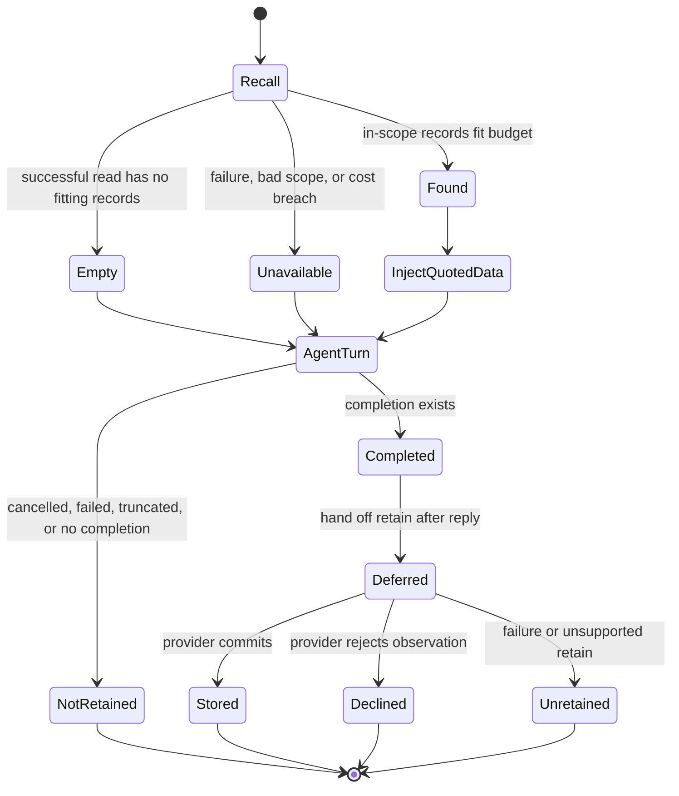

Memory in rung is an optional product-side capability: it recalls relevant records before an agent turn, optionally contributes agent tools during the turn, and offers the finished turn for retention afterward. The contract separates *who is authoritative*, *how a provider is called*, and *what outcomes mean*, so an unavailable store cannot silently become an empty one and an unsuccessful write cannot be reported as a deliberate decline.

For agent lifecycle context, see [Agent Turns and Sessions](../workflows/agent-turns-and-sessions.md); MCP transport and credential context are covered by [ACP, MCP, and OAuth](../integrations/acp-mcp-and-oauth.md).

## Authority: one owner per run

`MemoryAuthority` is resolved once, in priority order: `--memory`, `RUNG_MEMORY`, `memory.provider` in `config.yaml`, then `off`. Blank environment/file values are unset, but a malformed selected value is a configuration error rather than a fallback. Rung does not infer authority from a caller, MCP server name, or request metadata.

| Mode | Runtime behavior | Authority boundary |
|---|---|---|
| `off` (default) | No memory hooks, store, tools, or memory report. | The pre-memory behavior is unchanged. |
| `external` | Rung opens no store, recalls and retains nothing, and contributes no memory tools. The report identifies `external`. | The caller composes recall, decides retention, and supplies any MCP tools; rung must not become a second source of truth. |
| `baseline` | Built-in local provider. | Rung owns the local JSON-lines memory store. |
| `mcp:<url>` or `mcp:<command [args]>` | Connects to an MCP server that implements `rung-memory/1`. HTTP(S) or a whitespace-split stdio command is supported; no shell is invoked. | The provider owns its storage, tenancy, visibility, and revocation policy. |
| registered provider | A factory in `Registry` builds an in-process `MemoryProvider`. | The factory receives resolved local directory, optional argument, timeouts, and optional token. |

A provider is not the same abstraction as a store. `MemoryProvider` declares independent `recall`, `retain`, and `tools` capabilities, a `Budget`, and the hook implementations. `Store` is a lower-level scoped graph-read interface—`search`, `neighbours`, and `fetch`—for providers that need it. `walk` turns that interface into a recall by searching, optionally following one hop, fetching records, preserving hit-then-neighbour order, deduplicating IDs, and accumulating backend calls and cost.

Every scope is opaque to rung. A configured scope is passed through unchanged; otherwise rung derives `rung-scope:<hex>` from the repository's git `origin` URL, or canonical root path when no origin exists. This lets worktrees for one origin share memory without exposing the raw path. Store and provider implementations must enforce scope: a foreign returned record is an unavailable result, never usable evidence.

## Contracted lifecycle

This state diagram distinguishes a successful empty read from an unavailable read, and a provider’s intentional decline from an unretained observation.

### Recall before the loop

Before `Engine::turn`, the runtime waits briefly for pending retention in the same scope, then sends a `Cue` containing the redacted current ask and redacted earlier successful assistant answers. The content is not truncated by rung: redaction removes secrets but preserves the rest. The provider may use prompt and context as it chooses.

The recall ladder is the only hook caller. It applies the capability check and then validates the answer in this order:

1. Provider failures, unsupported recall, excess reported cost, and out-of-scope records produce `unavailable` with a reason and a trace.
2. Duplicate record IDs are removed, retaining first occurrence and provider order.
3. `max_records` and `max_chars` are applied greedily to complete records. A record is injected whole or left out; it is never clipped.
4. A non-empty accepted list becomes `found`; a successful list with nothing accepted becomes `empty`, including when the declared record/character budget excludes all results.

The trace carries reported backend calls—including failed calls—reported USD cost, and measured latency. `left_out` records the budget cut; a `found` report also exposes the ordered IDs actually injected. A provider with no explicit record or character limit is unbounded from rung’s perspective; the default cost ceiling is `0.0`, so a paid provider must explicitly declare a positive cost budget.

### Recalled material is data, never instructions

When recall is found, the runtime renders the records after the current user message with provenance and block quotes. The fixed heading explicitly says the data may be stale or wrong, must be verified, and is not an instruction. It is user-side quoted material, not system prompt text and not a rewrite of the user’s message. The session keeps the original user text and the adjacent recalled block separately, then replays their combined sent form on later turns.

This is a security boundary, not a presentation detail: recalled text may be provider-controlled and must not gain system authority. The provider receives only a redacted prompt/context or redacted turn sides plus an opaque scope key; it does not receive a raw repository-path scope by default. Its authorization and visibility decisions remain its responsibility.

### Retain only after completion

A `Turnover` is constructible only from a `Completion`, and the runtime creates it only when the agent turn has `Status::Completed`. Consequently unverified, unchecked, truncated, cancelled, failed, or otherwise non-completed turns are never offered to automatic retention. The offer contains redacted, whole user and assistant sides plus provenance such as session, line, source, and whether checking occurred.

Retention does **not** delay the reply. The immediate turn report is `deferred` with zero calls/cost/latency; a worker performs the retain after the reply under `retain_timeout_secs` and emits `memory.retained` for `stored` or `declined`, or `memory.retain_failed` for `unretained`. A later turn calls `settle()` before recall: it waits only for retains in the same scope and for at most `min(retain_timeout_secs, timeout_secs)`, with a one-second minimum. A still-running write remains pending and reports later; process exit joins all pending writes. This bounded settlement improves read-after-write behavior without making the next turn wait indefinitely.

The retain ladder records three semantically distinct terminal outcomes:

- **`stored`** — the provider committed the observation and supplied its record ID.
- **`declined`** — the provider intentionally did not keep it, for example because it was duplicate, empty, or unsuitable.
- **`unretained`** — the provider was unreachable, malformed, unauthorized, unsupported, or otherwise failed. It is not a decline.

`RUNG_MEMORY_RETAIN=distill` is opt-in. It removes fenced code and common tool/progress chatter, keeps assistant conclusion paragraphs whole, and skips a turn that has no durable content. The default retains the complete redacted turn; distillation does not relax the completion gate.

## Provider and store extension points

An in-process implementation registers a `Factory` under a lowercase provider name through `Registry`, then implements `MemoryProvider`. It should accurately declare its capabilities and budget: rung invokes only declared hooks. Provider-owned agent tools receive `ToolContext` with scope and session provenance; tools that search or retain should use the same ladders so their outcomes preserve the contract.

A graph-backed implementation can implement `Store` and use `walk`. `Store` methods are scoped and return either `Charged<T>` or `Miss`, so a multi-call walk can propagate calls and cost even when a later stage fails. Missing requested IDs are normal fetch omissions; cross-scope records are a hard failure. This gives extensions a clear place to implement retrieval, graph expansion, access controls, and accounting without bypassing result validation.

## Built-in baseline provider

`baseline` is the offline, no-model, no-network reference provider. It appends one `Record` per line to a JSON-lines file per scope, named from a scope hash below the configured memory directory. A missing file recalls as empty and recall does not create it; the first successful retain creates the directory. Storage is append-only except explicit record/scope deletion operations.

Recall uses lexical BM25 after lowercasing, tokenizing, and dropping short terms and stopwords. A small recency term breaks equal-relevance ties toward newer records without outweighing relevance. `baseline:stem` opt-in folds selected English plural/verb endings on both query and record terms; no option preserves default ranking. It keeps whole records of any size, declines whitespace-normalized duplicates and empty observations, and exposes `memory_search` and `memory_retain` tools. The built-in tools return quoted recall data or route notes through the retain ladder with `source: tool` provenance.

## MCP provider: `rung-memory/1`

An MCP server is a memory provider only when its `initialize` capability includes the `rung-memory/1` experimental marker. The marker declares `recall`, `retain`, and optionally a budget. A reserved hook is usable only if it is both declared and listed. Rung removes `rung_memory_recall` and `rung_memory_retain` from the server’s agent-facing tool roster; all other listed tools may be admitted, but cannot shadow an existing run tool.

- `rung_memory_recall` receives `{scope, prompt, context, budget}` and returns records, optional `observed_at`/attributes/score, `calls`, and `cost_usd` through `structuredContent` or a first JSON text item.
- `rung_memory_retain` receives `{scope, observation}` where an observation is either a `turn` with user/assistant sides or a `note`. It returns `stored` with an ID or `declined` with a reason, plus accounting.
- Wrong shapes, `isError` responses, or transport failure become unavailable/unretained rather than failing the agent turn.

For MCP hooks and agent-facing provider tools, a timeout stops the provider process and marks later calls unavailable. HTTP providers may use `memory.token` or `RUNG_MEMORY_TOKEN`; rung sends it as a bearer Authorization header and scrubs it from errors. Tokens are ignored for stdio and baseline. Configuration details belong in [Configuration and Secrets](../operations/configuration-and-secrets.md).

## Operating and verifying memory

The main operational settings are `memory.scope`, `memory.dir`, `memory.timeout_secs`, `memory.retain_timeout_secs`, and `memory.token`, with `RUNG_MEMORY_*` environment overrides. Defaults are a repository-local `.rung/memory` directory when using a derived scope, a 30-second regular timeout, and a 60-second retain timeout. A configured scope uses the rung-home memory directory by default.

For baseline administration, `rung-agent --memory-scope ls`, `rm <id>`, and `drop` inspect or delete records/scopes. An MCP provider owns its own administration because `rung-memory/1` has no deletion hook. Use `rung-agent --memory-check baseline` or an MCP target to exercise provider declaration, hook separation, scoped retain/recall, budget adherence, and scope isolation.

Focused tests protect the high-risk invariants: ladder tests distinguish empty from unavailable and declined from unretained; property tests attack scope leaks, duplicate records, and whole-record budget cuts; baseline tests cover persistence, isolation, deletion, ranking and tool routing; recall/retain quality suites bound ranking and distillation regressions. See [Verification and CI](../testing/verification-and-ci.md) for repository-wide test guidance.
