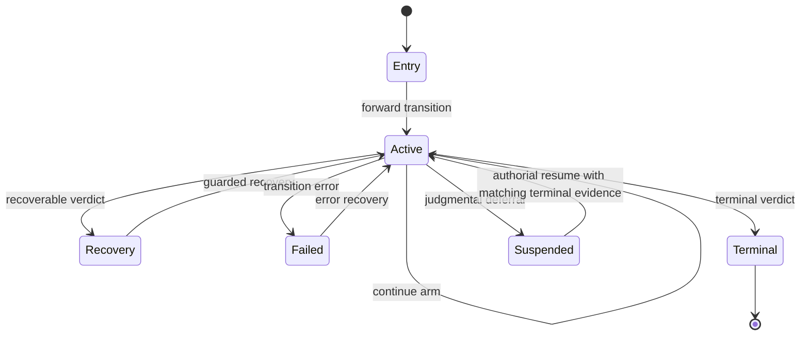

`rung` expresses workflow structure as a compile-time state machine rather than as an enum plus conventions. `ladder!` declares the states and permitted arrows; Rust ownership and macro-generated types make a live state token evidence that the prior arrow was traversed. Het adds a separate axis: whether an operation is mechanically decidable, requires a non-identical outside judgment, or is an authorial transformation by a principal with standing.

This page describes the enforcement boundaries, not a catalog of generated symbols. For workspace ownership and crate boundaries, see [Workspace Boundaries](../architecture/workspace-boundaries.md); for project-level verification practice, see [Verification and CI](../testing/verification-and-ci.md).

## Ladder declaration and state lifecycle

A `ladder!` declaration supplies a linear spine of rungs and ends in a branching transition. Rungs have payloads and may carry immutable witness data. A branch can be terminal, recoverable (`Verdict => Rung`), or a continue arm (`Verdict -> Rung`). An optional inline `impl` supplies every declared transition body; those bodies expand inside the generated module, where they can invoke private downstream constructors.

This is the lifecycle emitted by `ladder!`: ordinary forward and branch outcomes, guarded verdict recovery, unguarded error recovery, and the residual suspension/resumption path available on judgmental forward transitions.

### Evidence-bearing tokens

The generated rung is deliberately not merely a payload wrapper:

- **States are linear capabilities.** Transitions take the source rung by value, so Rust prevents reuse after a move. Rungs and verdicts are also made `!Send + !Sync`, preventing a shared reference or `Arc` from moving a live token across threads. `#[must_use]` makes an unhandled token visible to the compiler, and becomes an error under `#![deny(unused_must_use)]`.
- **Construction is sealed at the module boundary.** With inline bodies, only the entry constructor is public. Later rungs and verdicts are made only by the generated transition code inside the module. This ensures a mid-ladder state represents traversal, rather than a caller’s claim that traversal occurred. This boundary does not defend against code inside the generated module, public entry construction, or a token trusted across a public crate boundary.
- **Carry is witness data, not mutable workflow state.** A `carry` block is cloned into rungs and exposed only through a shared reference. It stays available across transitions but cannot be mutated by a transition body.
- **Branch shape remains explicit.** `StepOutcome` is an enum, so clients must account for every declared terminal, recoverable, and continuation outcome. A terminal may carry a result payload; a recoverable verdict instead carries the source rung, preserving the context needed to recover.

The macro statically rejects malformed graph declarations: unknown targets, payloads on recoverable or continue outcomes, unpaired recovery, recovery from a terminal verdict, and incomplete or phantom inline bodies. These are expansion-time refusals, distinct from Rust’s ownership and exhaustive-match checks.

### Recovery is intentionally asymmetric

A verdict recovery is a claim that the workflow can re-enter after a particular outcome. The macro injects `must_progress`, comparing the source and produced payload and panicking when they are equal; this requires a shared `Clone + PartialEq` payload. The body cannot omit that check.

An error-path recovery instead consumes `Failed<Rung>`, which holds the unconsumed token and an error. It has no progress guard because retrying a transient operation may legitimately reuse the same state. A continue arm likewise constructs its target rung directly inside `step`; it has neither a recovery function nor a progress guard.

## Het: gates are distinct authority paths

Het’s model is that each sentence or operation has a gate determining how it is settled. `decidable` work is internal; `judgmental` work requires an outside principal; `authorial` work transforms a subject and requires standing over it. A fourth, `conditional`, gate is part of the formal model but is rejected by `ladder!`: it classifies decidability per model at a higher level and has no expansion-time encoding.

The implementation makes the two dispatched gates incompatible function signatures rather than annotations a body can ignore:

| Arrow kind | Capability supplied to the body | Admission condition |
|---|---|---|
| unmarked / decidable | no outside capability | internal computation |
| `#[judgmental(R)]` | consuming `Qualified<R>` | principal is capable of `R` and provenance-disjoint from the argument |
| `#[authorial(R)]` | `Authorized<'_, R>` pen | principal is capable of `R` and has standing over the subject’s container |

A role is a type, so a judgmental or authorial arrow must name the competence it requires. The pool remains one pool; the gate chooses which filter it applies. This matters because the filters are opposites in their second condition: a judge must not share authorship with what it judges, while an author must have standing to write to the territory containing the subject.

### Provenance-qualified judgment

`Prov` is a finite provenance-tag set. `Principal` declares its authored history and identity; the blanket `Provenanced` implementation derives the principal’s provenance as authored history plus its own identity. Thus a principal cannot construct an empty provenance that would qualify it to judge everything. On the argument side, `Pool::qualify` refuses an empty provenance instead of treating universal disjointness as meaningful.

`Pool::qualify` checks role capability and non-overlap, then mints a sealed `Qualified<R>` token that records both the chosen principal and the provenance of the specific argument. A token is consumed by a judgmental dispatch. Its `admit` check compares the stored argument provenance to the argument actually being judged, preventing an honestly minted token from being transferred to another subject.

The judgment result is sealed too. `Principal::judgment` calls the principal’s oracle and produces either a sealed `Judgment`, stamped with that principal’s provenance, or a `Raised` deferral. Callers cannot supply a bare verdict as if the judge had rendered it, and a deferral cannot be converted into a judgment. A forward judgmental ladder transition additionally receives injected guards that bind the licence to its source payload and require the target payload’s provenance to derive from the judge’s provenance. Together, token binding and outcome containment entail that the result is disjoint from the audited input.

`theory!` applies the same model to sentences: decidable sentence bodies receive only the model, while settling a judgmental sentence requires a qualified token and sealed judgment. `rung-het` re-exports these `rung` primitives and supplies the audit/rectify vocabulary built on them.

### Authorial gates and resumption

`Authorized<'_, R>` is a standing pen, minted only when the principal is both capable and authorized for a named container. The macro injects `must_hold_standing_over` before an authorial body, binding the pen to the source payload’s `Situated::container`; a pen for another container cannot be spent there. Standing is not consumed in the library model, though a ladder transition consumes its parameter as part of consuming all transition inputs.

A judgmental principal may defer by raising an opaque matter. For a judgmental **forward** arrow, that produces `Suspended<Prev>` holding the original rung unconsumed and the `Raised` reference. Suspension is not failure and is not a verdict. The generated `Awaiting` implementation reports the reference from the suspended run itself, so a driver need not—and cannot correctly—supply a separate claimed reference.

A `resume` edge is authorial because it writes a rung back into the ladder. It requires an authorized pen and `Terminated` evidence derived from the exact raised reference; injected guards reject a pen over the wrong container or evidence for another matter. Unlike ordinary verdict recovery, resumption has no progress guard: returning the unchanged subject is normal when the awaited matter took another round. This is deliberately not a termination guarantee; a matter with no terminal leaves its run visibly suspended, and suspension is in-process only rather than serializable state.

## Audit dispatch: Het vocabulary and domain-blind control

`rung_het` separates classification from transformation in an audit–rectify pass:

1. An audit yields a finding or no defect.
2. An author with standing creates a `Proposal`, whose provenance is the author’s rather than the audited model’s.
3. A provenance-disjoint qualified judge `dispose`s the proposal. The token must have been qualified against the proposal itself, not merely against the original model.
4. An affirming ruling can become a `Licence`; an authorial `enact` applies the domain edit using a standing pen. The destination can still reject the write under its own law.
5. A separate observer reads back whether the edit is in effect.

Judges classify; they do not amend proposals. Non-terminal dispositions carry reasons and re-enter authoring with chain history, while an affirming disposition yields permission for a separate authorial enactment. `Applies<E>` and `Verify<E>` are intentional extension points: the domain owns edit semantics and its observable confirmation, while Het retains the authority and provenance constraints around them.

`rung-driver` is the application layer, but is deliberately domain-blind: it configures principals, pools, carriers, parks, and theories without embedding a particular proposition or doctrine vocabulary. `Audit` exposes audit-only worlds. `Pass<E>` adds a typed remedy, post-judgment re-proposal, persistence hook, and the theory’s rule for combining a panel’s rulings. `run_cycle` chooses the first finding, mints an authorial pen, gathers all qualifying judges, lets the theory combine their rulings, enacts an affirmed edit, verifies it, and creates a dispatch record from each sealed judgment. A deferred judge produces `CycleOutcome::Deferred`.

The generic cycle makes one re-proposal after a rejection and then returns `Rejected`; the implementation explicitly treats this as a driver policy that surfaces additional work rather than silently looping. It does not rank qualifying judges: selection and any worth-based ordering remain outside Het. `rung-std` provides reusable blocks such as LLM calls, agent turns, and a park for suspended runs; the park itself does not introduce timeouts, ordering, depth caps, or re-entry bounds.

## Failure semantics and limits

The type-level protections are strong but scoped:

- `#[must_use]` is an affine lint aid, not language-level linearity; `mem::forget`, `let _ =`, and dropped containers can bypass it.
- Seals prevent external fabrication, not fabrication by code in the generated module or misuse after a public cross-crate API boundary.
- The macro enforces gate inputs and the provenance result of forward judgmental arrows, but does not prove arbitrary transition-body correctness. Authorial output provenance and branching judgmental outcomes remain body-level concerns.
- `#[conditional(..)]` has no implementation, and an unmarked arrow excludes Het’s principal-pool capability but is not a general purity proof against clocks, files, or networks.
- A `compile_fail` doctest establishes only that something fails to compile. Diagnostic-specific refusals are pinned with `trybuild` UI cases and committed stderr snapshots; regenerate those snapshots deliberately, not as routine output editing.

The proposition documents under `docs/` and their conformance material are rendered outputs of `rung-doctrine`. Change the encoded doctrine and renderer inputs, then render and verify them; do not hand-edit generated documents.

## Focused verification

The core end-to-end suite drives an inline ladder through recovery to a terminal payload, exercises continue arms and error-path recovery, and proves that an omitted explicit progress call still panics because the macro inserted it. Compile-fail `trybuild` cases pin private downstream constructors, must-use enforcement, malformed recovery declarations, use-after-move, and non-exhaustive outcome matches. The Het gate-law tests exercise decidable settlement without a principal, reject authoring judges and empty-provenance subjects, require capability, record oracle-provided judgments, and preserve reported uncertainty.
