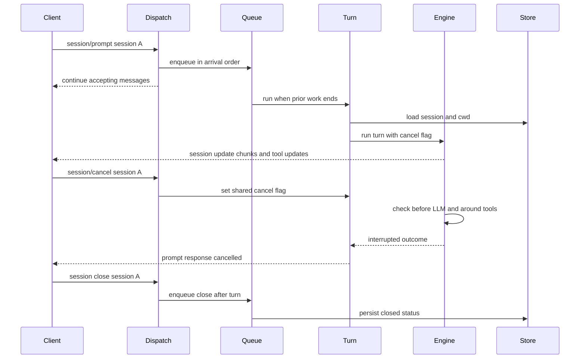

ACP, MCP, and OAuth are integration boundaries around the same turn engine. ACP is the client-facing control plane: it creates and addresses sessions, accepts prompts and cancellation, and forwards model and tool progress. MCP supplies additional tools to a turn. OAuth supplies a model credential without exposing its login material to a session, repository, or client.

For turn persistence and transcript semantics, see [Memory Providers](../concepts/memory-providers.md) and the agent-turn documentation when available. The key distinction on this page is that **ACP session state is durable session data, whereas MCP connections and OAuth's minted bearer are integration runtime state.**

## Entry points and boundary ownership

`rung-agent --acp` runs ACP JSON-RPC on standard input/output. By default, its stdio front process is a proxy that creates one detached `rung-agent --acp` worker per ACP session. The proxy relays JSON-RPC and `session/update` notifications unchanged, so a stalled, crashed, or resource-exhausted session worker does not block other sessions. Set `RUNG_ACP_WORKERS=0` to use the in-process implementation instead.

`rung-agent --acp-http [ADDR]` exposes the same agent over Streamable HTTP at `/acp`; the default address is `127.0.0.1:7331`. **This surface is explicitly experimental.** It is an in-process server, unlike the default stdio session-worker arrangement. `--acp-token TOKEN` makes the listener require `Authorization: Bearer TOKEN`; without that option its ACP authorization callback accepts requests. Do not expose an unauthenticated listener on an untrusted interface.

The agent advertises initialization, creation, load/list/delete/close/resume, mode selection, and fork capabilities, plus image, audio, embedded context, and MCP HTTP prompt capabilities. Its modes map to `explore`, `implement`, and `review`. A prompt turns ACP content blocks into the engine's text and multimodal blocks; assistant-audience annotations mark contextual text rather than the immediate ask.

## ACP prompt, cancellation, and serialization

A connection dispatch loop must remain available to receive `session/cancel`, close, and other requests while a turn is running. Therefore `session/prompt` reserves a queue position and is run in a spawned task rather than inside the request handler. The same queue also serializes session-file mutations that could race a turn.



This sequence shows why a cancellation notification can land during a queued or executing prompt, while close waits to write until the turn can no longer overwrite the session state.

### Process-wide ordering and cwd safety

Within one `Live` ACP implementation, the queue is **one FIFO for the entire process**, not one queue per session. Queue positions are assigned synchronously in message-arrival order. This deliberately prevents concurrent turns from racing the process-global current working directory: before calling the blocking turn runner, a prompt loads the session's recorded cwd and calls `set_current_dir`; no other queued turn may change it underneath that turn. A session's store is resolved from the cwd supplied to new/load/resume/fork, rather than from whatever cwd the process currently has.

That invariant has two operational consequences:

- In the single-process mode and ACP HTTP mode, prompts across sessions are serialized. A slow turn delays later queued turn and session-write work, but not lightweight dispatch handlers such as list or cancel.
- Default stdio workers isolate each session in a separate process, so their process-wide queues and cwd changes are separate. The proxy replays `initialize` into workers and routes requests by `params.sessionId`.

The stdio proxy restarts a dead session worker on a later message and resumes it from the session file before forwarding ordinary work. Restart backoff starts at 250 ms, doubles up to 30 seconds, and stops after five consecutive failures; a worker alive for 30 seconds resets the failure run. Requests open when a worker dies receive an error. This is process supervision, not a promise that an interrupted turn completed.

### Cancellation boundaries

Cancellation is cooperative. `session/cancel` removes the current per-session cancel flag from `Live` and sets it; all prompts that had already acquired that flag—whether running or waiting in the FIFO—observe cancellation, while a prompt arriving afterward gets a fresh flag. A cancel between turns is therefore a no-op for the next turn.

The engine checks the flag before each LLM call and around each tool invocation. A request already in an external provider or tool cannot be retroactively made unobservable: cancellation takes effect at those checks. HTTP MCP calls additionally race in-flight network work with a cancellation watcher; a cancelled operation reports an unknown outcome and should not be retried under a new operation identifier. An ACP prompt whose cancel flag is set ends with ACP `stopReason: cancelled`, including when another failure happens after cancellation.

`session/close` and `session/delete` first cancel the session, then enqueue their persistent write/delete after earlier work. This ordering prevents a turn's final save from recreating a deleted file or replacing the closed state.

### Session state, system text, and updates

At `session/new`, the adapter reads `_meta.systemPrompt`, ignores blank values, stores it in the newly created `Session`, and keeps a live copy for the current process. The turn appends this session-specific text to the configured system prompt. Crucially, the persisted `Session.system` is the fallback after a load, resume, fork, or fresh worker/process: the transient `Live` map is not the source of truth after reconstruction.

`session/load` emits the last assistant text as a `session/update` before replying; `session/resume` restores state without replaying it. During a prompt, model thinking and message deltas become ACP thought/message chunks, usage becomes a usage update, and tool execution is wrapped to emit `ToolCall` followed by a completed or failed `ToolCallUpdate`. If streaming produced no text chunk, the final turn text is sent once at completion. Terminal turn failures are mapped to ACP stop reasons where possible and otherwise to an internal JSON-RPC error with structured `rung.terminal` metadata.

## Streamable HTTP transport

The HTTP listener accepts `POST`, `GET`, and `DELETE /acp`:

- `POST` with JSON initializes a connection or forwards later JSON-RPC to it. Initialization returns an `Acp-Connection-Id`; later work is accepted with HTTP 202.
- `GET` with `Accept: text/event-stream` opens the outbound SSE stream. `Acp-Session-Id` selects a session stream; without it the connection stream is used. Only one active receiver may lease a given outbound mailbox.
- `DELETE` with `Acp-Connection-Id` tears down that connection and aborts its streams.

With `Serve.bind_bearer`, every later request must carry the same bearer token used at initialization; the built-in `rung-agent` server currently authorizes each request but leaves that binding disabled. The reusable `Serve` API can also host non-ACP routes. Its route gate can reject a request from headers before reading its body; admitted large route bodies spill after 1 MiB to an unlinked, mode-0600 temporary file rather than being held entirely in memory. This body-spooling behavior is an embedding facility and does not change ACP session persistence.

## MCP tools: discovery, failure, and reconnection

MCP is a product-layer `Toolset`, not kernel state. `McpSpec` supports streamable HTTP (`name=url` for `--mcp-http`) and spawned stdio servers with arguments and environment. ACP-provided HTTP, SSE, and stdio server descriptions are converted into these specs for that session's prompt.

When a roster connects, it initializes each server (trying protocol versions `2025-03-26` then `2024-11-05`), sends `notifications/initialized`, calls `tools/list`, and exposes the discovered definitions to the model. Duplicate remote tool names are disambiguated by prefixing later duplicates with the server name. HTTP requests retain an MCP session id returned in `Mcp-Session-Id` and send it back on later requests; supplied MCP headers are registered for redaction.

MCP failure handling is deliberately separate from transcript persistence:

- A roster belongs to an `Engine` instance. It is not serialized into the ACP `Session`, and an HTTP MCP session id or a live stdio child is not recoverable from a saved conversation.
- A stdio wire can report that its child exited. Before a turn, an engine detects a non-alive roster, reconnects from its configured `McpSpec`s, replaces the roster, and aborts the old wires. Reconnect success or failure is emitted as an event.
- Initial connection, handshake, or tool-list failure prevents that engine setup. Tool-call failures are returned as structured, redacted MCP errors. HTTP calls have a 300-second default total timeout and only make a second attempt when the tool was declared idempotent and supports `operation_id`; retries reuse the same operation id.
- In an ACP session, the specs are held in the live adapter state and supplied for the prompt's engine setup. On resume/load, the client supplies `mcpServers` again; the stdio proxy remembers specs only to resume a restarted worker. None of this makes an MCP connection part of the durable session file.

This means a successful ACP session resume restores conversation and its persisted system text, but does not assert that a remote MCP server is reachable or that a prior external tool operation completed.

## OAuth credential lifecycle

OAuth replaces `llm.api_key_env` when configuration selects `llm.auth.oauth` with a provider and optional profile; `RUNG_OAUTH_PROVIDER` and `RUNG_OAUTH_PROFILE` can select them per process. The turn engine receives only the `CredentialSource` abstraction: an OpenAI-compatible route, a bearer, and optional headers. Login, token exchange, storage, and renewal remain in `rung-agent-core::oauth`.

The current registry provides `github-copilot`. Operators use:

```text
rung-agent auth login  <provider> [--profile NAME] [--enterprise DOMAIN]
rung-agent auth status [<provider>]
rung-agent auth models <provider> [--profile NAME] [--refresh]
rung-agent auth logout <provider> [--profile NAME]
```

Login is a device-code flow: the command prints a verification URL and user code and waits, so the browser can be on another machine (including when the agent host is reached over SSH). It does not print tokens. Status describes token freshness, models lists account models, and logout removes the named profile.

**OAuth login material is machine-local, not session data.** The store is `$RUNG_HOME/oauth/<provider>--<profile>.json` (normally `~/.rung/oauth/`), with a private directory and 0600 files. It contains the long-lived login and most recent minted bearer; writes replace the file atomically and names are validated as safe path components. Do not commit or copy this directory as part of a workspace or ACP session. Tokens are also redacted from MCP diagnostics and configured header values.

For Copilot, the durable login exchanges on demand for a short-lived bearer. A valid minted bearer is cached in memory and in the local login file, refreshed when fewer than five minutes remain, and coordinated by in-process and file locks so competing local processes reuse one mint. A rejected bearer is cleared and retried once with a newly minted bearer; a missing, revoked, or inaccessible login is an actionable auth failure rather than a hot retry loop. This is independent of ACP cancellation and session recovery: ACP stores the conversation; OAuth stores credentials locally; MCP manages its own remote connection lifecycle.

## Focused verification

The integration tests exercise the boundaries that are easiest to regress:

- `rung-agent/tests/acp_concurrency.rs` verifies that requests and cancellation land mid-turn on both stdio and HTTP, queued prompts are cancelled, close survives a turn's final write, and prompts remain serialized.
- `rung-agent/tests/acp.rs` verifies ACP capabilities, session load versus resume behavior, terminal wire states, replay of prior tool history, and session-cwd ownership.
- `rung-agent-core/tests/acp_http_body_stream.rs` verifies early route rejection, disk spooling of a 256 MiB admitted body with bounded memory growth, and close-on-spool failure.
- `rung-agent/tests/oauth.rs` verifies that CLI output does not leak login or minted tokens, files are mode 0600, two processes reuse one minted token, and a missing login points to the repair command.
