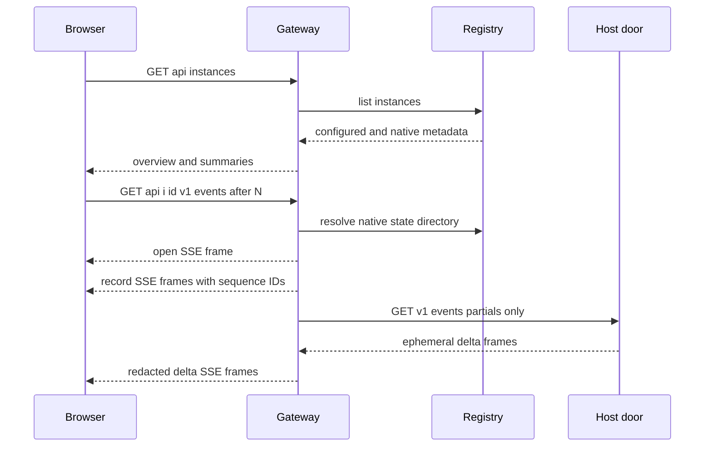

`rung-gateway` is the single HTTP listener in front of one or more rung hosts. It serves the built observer app, discovers or probes instances, and exposes each host only beneath `/api/i/{id}/v1/...`. It is deliberately a boundary rather than a second host: it retains per-instance owner keys, adds one only on an upstream request, and keeps those keys out of pages and responses.

## Boundary and deployment posture

Run the listener with a YAML file whose secret-bearing values are **environment variable names**, not YAML values:

```text
rung-gateway --config gateway.yaml
```

`listen` defaults to `127.0.0.1:8787`; `app_dir` and `registry_dir` may be relative to the config file. Configured instances require a path-segment-safe `id`, an `http://` host listener URL, and `key_env`; startup rejects duplicate IDs, missing or empty variables, non-HTTP URLs, unknown config fields, and keys that cannot be represented safely as an HTTP header. Resolved settings deliberately render only the number of read-only tokens in `Debug` output.

The gateway is intended to be exposed through the tailnet rather than to provide a conventional login system. A request with no token is the **owner** role; a request bearing a configured read-only token is the **read-only** role. The token can be in `Authorization: Bearer …` or the `token` query parameter (useful for stream clients), is consumed at the gateway, and is never forwarded. Any supplied malformed, empty, duplicate, or unknown credential is `401 unauthorized`; a stray bad token cannot silently become an owner request.

Owner requests are also defended against DNS rebinding: every `/api` owner request must name loopback, the specific non-loopback bound address, or a configured `allowed_hosts` name in `Host`. Owner writes additionally require a supplied `Origin` to match that host and effective port; scripts without `Origin` remain valid. Read-only requests bypass those owner guards but cannot write: the gateway returns `403 read_only` before an upstream call. This is access classification and tailnet posture, not user authentication.

## Routes, instance sources, and proxying

| Route | Responsibility |
| --- | --- |
| `GET /api/health` | Returns `{"ok":true}` for UI mode detection. |
| `GET /api/instances` | Lists configured instances and native registry entries with a summary or an explicit reachability/error state. |
| `/api/i/{id}/v1/...` | Selects one instance and exposes only its host `/v1` doors. |
| non-`/api` GET/HEAD | Serves a file from `app_dir`, or `index.html` for extensionless client routes. |

A configured `Registry` is queried on every request, so an implementation may make membership dynamic; `StaticRegistry` is the config-backed default. The overview probes configured hosts' `/v1/summary` with their retained key and a five-second bound. An unreachable host remains in the list with `reachable: false`, rather than disappearing.

`registry_dir` adds **native** hosts from their local state directories. Native overview, summary, record, context, queue read, and event replay can work while the host is stopped because these reads use the host's record and state lock rather than asking a listener. If an ID is both native and configured, there is one registry-owned overview row: native-readable doors use the state directory, while other available doors may use the configured listener. The gateway has no start door.

For normal configured proxying, the gateway preserves method, body, query (after removing its `token`), and end-to-end headers such as `Last-Event-ID`; it removes client `Host`, `Authorization`, and `Cookie`, then supplies `Authorization: Bearer <instance key>`. Upstream response headers and body are passed through without buffering, preserving SSE timing. An unknown instance or non-`/v1/` target is not proxied; unsafe decoded path segments (`.`, `..`, separators, or NUL) are rejected. Connection failures become `502 instance_unreachable` without revealing a key.

## Door access classification

`rung_gateway::doors::DOORS` provides the explicit access table used to enforce the read-only role. The current read doors include summary/status/report, record/turns/decisions/pack/spend, events, queue listing, config retrieval, console retrieval/streaming, and per-turn context. Queue creation, cancellation and move; config validation/update; stop; and release are writes. A future door absent from the table is conservatively classified by method: `GET` and `HEAD` read, all other methods write.

This policy is enforced at the gateway before host routing. It does not claim that every named host door is necessarily served natively: a native instance without matching configured listener/key data returns `404` for doors the gateway cannot satisfy from its state directory.

## Native read model and redaction

The host-door contract is record-first: a record is the durable source of truth, and reader doors derive data from it without modifying it. Native `GET /v1/summary` replays the record into the host state fold and combines it with state-lock liveness. `GET /v1/record` offers caller-controlled pagination (`offset`, `limit`, `after`, `order`) with exact totals; it can stream a large JSON response through a small bounded channel and aborts a stalled reader rather than accumulating an unbounded page in memory. A torn last line is treated as an in-progress write; corruption yields the intact prefix plus damage information.

The gateway builds a redactor from its read-only tokens and instance keys, and extends the per-request redactor with keys from the current registry. Native state-directory reads and event frames are redacted before leaving the gateway; the record on disk remains verbatim. This protects both known credential shapes and retained exact secrets. It is still an operational requirement to run the gateway with the environment values needed to redact config-named secrets; unavailable names are reported as `redaction.env_unset`, not evidence that an unknown plaintext value is safe.

For native writes such as queue/control operations, the gateway first determines that the host is running, and it only uses the owner key named in **the gateway's own** `instances[].key_env`. A registry entry or host configuration cannot cause the gateway to read an arbitrary environment variable. When using a registered address, it will only send that key to a loopback, private, link-local, tailnet, or IPv6 unique-local address.

## Records versus live event deltas

`GET /api/i/{id}/v1/events` is SSE. It begins with `open`, sends durable `record` frames after the requested cursor, can follow appended lines, and ends with an `end` reason when a non-running or damaged record finishes. A record frame has an SSE `id` equal to its sequence number, allowing `Last-Event-ID` to resume. Replay and follow are one ordered record reader, so an append at the seam is neither missed nor duplicated.

`delta` frames are different: they are ephemeral in-memory model text and tool-progress updates for clients connected at that moment. They have no SSE ID, are not written to the record, and are never replayed. A slow delta consumer can receive `behind`; it must use the durable record to recover final state. The gateway can relay partials from a running native host through `GET /v1/events?partials=only`, but if that host cannot be contacted or does not yield a usable token, the durable record stream still works with `open.partials: false`.



*Browser requests are routed through the gateway; numbered record frames are replayable, while relayed deltas are live-only.*

## How the React observer uses the boundary

The React app asks `api/health` once. If it succeeds, it loads `api/instances`; otherwise it uses static, prepared `data/index.json` and record files. This lets the same build be served as an offline observer or beside the gateway. Hash routes select the instances, now, turns, and context pages, and the gateway's extensionless-app fallback supports opening the built app independently of server-side route handling.

In live mode the overview refreshes every five seconds. Opening an instance creates one shared `LiveStore` for its pages: it pages through `/v1/record` first, then follows `/v1/events` from the last durable sequence. Incoming record lines are batched briefly for rendering and trigger a summary refresh; the host summary remains authoritative for the displayed state word.

`EventsClient` maintains its last applied sequence, sends it in both query construction and `Last-Event-ID`, ignores overlaps, and treats a sequence gap as a reason to reconnect rather than apply questionable state. `409 cursor_ahead` reloads the record; `404` stops following and retains the data already loaded. After a terminal stream it periodically checks whether the instance returned.

The UI deliberately handles deltas as a transient overlay rather than record state. It waits until replay is caught up, suppresses text for a turn already running when it joined or after a cut, clears partial text on `behind`, and clears it when the durable `turn.ended` arrives. It applies another client-side redaction pass to loaded and streamed content as defense in depth.

Queue submission is owner-only in practice: `Sender` posts `{ key, text, intent }` to `/v1/queue`, coalesces a repeated in-flight press, and retains the same idempotency key after an uncertain transport/upstream failure so retry can add the item once. A read-only `403`, a stopped host, missing door, or known key/address refusal is presented as a definite refusal instead.

## Verification focus

Gateway integration tests cover proxy credential replacement, cookie removal, SSE non-buffering and resume headers, read-only refusal before the host, host/origin guards, path traversal resistance, static-app fallback, and no-key response canaries. Native-door tests additionally exercise stopped-host reads, liveness words, record pagination and damage, redaction of state-derived responses, and state-directory read-only behavior. Event tests cover replay-to-live ordering, reconnection cursors, clean terminal streams, record/delta separation, partial relay/redaction, and clients that disconnect or read slowly.

The UI contract suite can run against a real gateway using `RUNG_CONTRACT_URL` and `RUNG_CONTRACT_INSTANCE`; it verifies the summary and paging shapes, SSE ordering/resume semantics, role boundary, terminal stop behavior, and absence of host keys from answers, frames, and headers.
