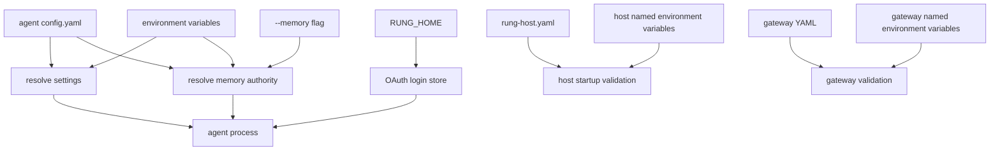

Rung has several deliberately separate configuration and persistence surfaces. Treat them as different ownership domains: the agent has an XDG configuration file, `RUNG_HOME` holds machine-local shared state and OAuth logins, each workspace has its own `.rung` session and usually memory state, a host has an explicitly configured state directory, and the gateway has an explicit YAML file. None is a place to commit a credential value.

## Safety rules

- Put configuration files and state directories outside source control. Configuration records *environment-variable names*, not secret values.
- Export credentials only in the process environment or use the OAuth login store. Do not put keys or bearer tokens on a command line, in YAML, in a workspace, or in a repository.
- Keep state directories distinct per concurrently running host. A host acquires a state-directory lock before it creates or opens its durable state.
- An unset LLM key is not a loader error: it produces no authorization header, which is useful for unauthenticated local endpoints but will produce an authorization failure at a protected endpoint.



This shows the separate resolution paths: agent settings are layered, memory has a CLI override, and host and gateway configuration resolve named environment variables during validation.

## Local files and state boundaries

| Surface | Default location | Purpose and operational boundary |
|---|---|---|
| Agent configuration | `$XDG_CONFIG_HOME/rung/config.yaml`, or `~/.config/rung/config.yaml` | User/machine configuration for `rung-agent`: `llm`, default `tools`, `turn_check`, `memory`, and OAuth provider settings. `RUNG_CONFIG` selects another config file. |
| `RUNG_HOME` | `$RUNG_HOME`, or `~/.rung` | Machine-local Rung home shared by product facilities. It is not the agent XDG config directory. |
| OAuth logins | `$RUNG_HOME/oauth/` | Per provider/profile login JSON and lock files. The directory is created mode `0700`; login and lock files use mode `0600`. |
| Host registry | `$RUNG_HOME/instances/` | One persistent `<id>.json` entry per registered host. Entries remain after stop or crash; liveness is derived from the host state lock and record, not from deletion. |
| Workspace session state | `<cwd>/.rung/sessions/<id>.jsonl` | Agent session history local to the current workspace. Older `<id>.json` sessions remain readable. Do not confuse this with `RUNG_HOME`. |
| Workspace memory state | `<repo-root>/.rung/memory` | Default local-provider directory when memory uses its default scope. Worktrees share the default scope because it is derived from the repository identity. |
| Named-scope memory state | `$RUNG_HOME/memory` | Default local-provider directory when `memory.scope` is explicitly configured, unless `memory.dir` overrides it. |
| Host state | `state:` in `rung-host.yaml` | Durable host record (`record/`), state lock, and—when enabled—baseline memory at `state/memory`. It is independent of the workspace `.rung` directory. |
| Gateway configuration | Path supplied to `rung-gateway --config` | Explicit YAML for the gateway listener, UI directory, allowed hosts, read-only token environment names, native-host registry, and proxied instances. Relative `app_dir` and `registry_dir` paths are anchored beside this YAML. |

The OAuth store is separate from the older `~/.rung/auth.yaml` provider-to-key map used by the driver. OAuth login data is structured and is atomically replaced, so it must not be inserted into that flat map. Profile and provider names are constrained to safe path-component characters before a login path is formed.

## Agent configuration and precedence

### Config file selection

`rung-agent` first chooses the config path:

1. `RUNG_CONFIG`, when non-empty;
2. otherwise `$XDG_CONFIG_HOME/rung/config.yaml` when `XDG_CONFIG_HOME` is set;
3. otherwise `~/.config/rung/config.yaml`.

A missing agent config file is acceptable. For normal LLM fields, non-empty `RUNG_*` values override file values, which override built-in defaults. Relevant environment overrides include `RUNG_BASE_URL`, `RUNG_MODEL`, `RUNG_PROTOCOL`, `RUNG_TIMEOUT_SECS`, `RUNG_IDLE_TIMEOUT_SECS`, `RUNG_MAX_TOKENS`, `RUNG_TEMPERATURE`, and `RUNG_REASONING_LEVEL`; `RUNG_IMAGES` overrides `llm.images` and defaults to off.

Use a file that names the key variable but never supplies the key:

```yaml
llm:
  base_url: http://127.0.0.1:8080/v1
  model: local-model
  api_key_env: RUNG_LLM_API_KEY
  protocol: openai-compatible
  timeout_secs: 120

memory:
  provider: baseline
```

If `llm.api_key_env` is configured, that named variable is authoritative: `rung-agent` does not fall back to `RUNG_API_KEY` or `XAI_API_KEY`. If it is absent, resolution tries `RUNG_API_KEY` and then `XAI_API_KEY`. `RUNG_KEY_FILE` can itself name the environment variable to use. The file should therefore remain safe to share only if it contains variable names and non-secret endpoint/model settings.

### Memory-specific resolution and state

Memory is off by default. Its authority has a narrower, documented precedence:

1. `--memory off|external|baseline|mcp:URL|mcp:COMMAND`;
2. `RUNG_MEMORY`;
3. `memory.provider` in `config.yaml`;
4. `off`.

`RUNG_MEMORY_SCOPE`, `RUNG_MEMORY_DIR`, `RUNG_MEMORY_TIMEOUT_SECS`, and `RUNG_MEMORY_RETAIN_TIMEOUT_SECS` override their file counterparts. Use `RUNG_MEMORY_TOKEN` for a provider bearer rather than writing a token into configuration. Unknown authorities, invalid numeric overrides, and invalid token material are resolution errors.

With no explicit `memory.scope`, the default scope is a hashed repository identity—Git remote origin when available, otherwise canonical repository root—and the local store defaults to `<repo-root>/.rung/memory`. This gives a main checkout and its worktrees a shared scope without exposing the path in the scope key. An explicit scope instead defaults its local store under `$RUNG_HOME/memory`; `memory.dir` or `RUNG_MEMORY_DIR` changes the directory in either case. See [Memory Providers](../concepts/memory-providers.md) for recall, retain, and provider behavior.

Memory provider reachability is intentionally not a startup failure after a known provider has been selected: unavailable hooks report typed memory outcomes rather than failing the turn. Recall occurs before a turn; retain is only offered after a completed turn and runs after the reply.

### Turn check and OAuth selection

`turn_check` is off by default. `RUNG_TURN_CHECK` selects `off` or `jev` and overrides `turn_check.backend`; `RUNG_TURN_CHECK_BASE_URL` overrides its endpoint. The turn-check key field is also an environment-variable name, `turn_check.api_key_env`.

OAuth is an alternative credential source selected by `llm.auth.oauth` or, per process, `RUNG_OAUTH_PROVIDER` and `RUNG_OAUTH_PROFILE` (environment wins). OAuth cannot be configured beside `llm.api_key_env`, clears any resolved API key, requires a valid provider/profile name, and is limited to the OpenAI-compatible route rather than the Anthropic Messages protocol. Loading this configuration performs no network request.

Create and inspect a login with the agent’s auth commands; the device flow prints an approval URL and code but not the token:

```bash
rung-agent auth login github-copilot --profile work
rung-agent auth status github-copilot --profile work
rung-agent auth logout github-copilot --profile work
```

The login store uses whole-file replace and a cross-process file lock, so concurrent processes share a newly minted short-lived credential rather than racing to overwrite it. For protocol and provider details, see [ACP, MCP, and OAuth](../integrations/acp-mcp-and-oauth.md).

## Host configuration: validate before state is opened

A production host is started with an explicit config:

```bash
rung-host run --config rung-host.yaml
```

Startup reads `rung-host.yaml` with unknown fields refused, validates its settings, resolves every required named environment variable, and constructs the engine **before** it opens the record. A refusal at this stage does not touch host state. The startup path then lists models when configured, acquires the state lock, registers the host when invoked by `run`, opens/replays the record, and hands the recovered host to its loop. A failed model listing does not itself prevent startup.

For `engine.kind: agent`, both `engine.base_url` and `engine.api_key_env` are required; the latter names a non-empty environment variable. `engine.kind: mock` is a deterministic no-network engine and needs neither. Host config also rejects an empty ladder, negative `idle_time_s`, and `web_spill_bytes: 0`. Its default is idle mode; set `idle_time_s: 0` for continuous operation.

A minimal **mock/simulation** config is safe for demonstrations, but is not a production engine configuration:

```yaml
state: demo/state
workspace: demo/sandbox
inbox: demo/inbox
stop_file: demo/STOP
engine:
  kind: mock
memory: false
idle_time_s: 0
```

Run it with a bound number of turns when testing plumbing:

```bash
rung-host run --config rung-host-mock.yaml --turns 3
```

The `rung-host sim` command is also a mock/fake-world harness and makes no network call; do not mistake it for validation of an external provider. The quickstart’s mock flow is documented in `docs/rung-host-quickstart.md`.

### Host ACP tokens and registry

Host ACP-over-HTTP configuration maps roles to environment-variable names under `acp.tokens`. HTTP requires at least one role token, and distinct roles cannot resolve to the same token value. The host builds a redactor from values of environment variables named in the file so those values do not escape through its records or doors. `acp.stdio` and `acp.http` are mutually exclusive.

`rung-host run` registers the instance before opening the record at `$RUNG_HOME/instances/<id>.json`. Registration prevents an ID from pointing to two state directories and prevents a state directory from receiving two IDs. It does not remove a record when the host stops: use the state lock plus final record line to distinguish `running`, cleanly `stopped`, `down` after an unclean end, and `unreadable`.

```bash
rung-host ls
rung-host ls --json
```

For host lifecycle and continuous versus idle operation, see the host operations documentation when available; the gateway’s view of registered hosts is covered in [Gateway and UI](../integrations/gateway-and-ui.md).

## Gateway configuration and fail-closed validation

Start the gateway only with its explicit config argument:

```bash
rung-gateway --config gateway.yaml
```

The gateway defaults its listener to `127.0.0.1:8787`; use an intentional deployment layer to expose it beyond loopback. Its YAML has strict unknown-field rejection. It may name read-only token variables in `read_only_token_envs` and each proxied instance’s owner-key variable in `instances[].key_env`; the resolved settings retain the secret values internally and deliberately omit them from `Debug` output.

At load time the gateway anchors relative `app_dir` and `registry_dir` paths to the config file’s directory. At resolution time it rejects:

- an invalid listen socket address;
- an unset or empty named token/key environment variable;
- an instance ID other than letters, digits, `-`, and `_`, or a duplicate ID;
- an instance URL not beginning `http://`;
- a key that cannot be carried safely in an HTTP header; and
- an `allowed_hosts` entry that contains a scheme, port, path, whitespace, `@`, or `[`.

The process reports configuration/resolve errors and exits with status 2; failure to start the server after successful validation exits with status 1. Gateway configuration can also point `registry_dir` at native host registrations: it reads their state directories whether the hosts are currently running or not. See [Gateway and UI](../integrations/gateway-and-ui.md) for its routing and UI boundary.

## Focused operational checks

Use commands that test the surface you changed, without injecting a credential into shell history or a source file:

```bash
# Agent configuration and memory resolution tests
cargo test -p rung-agent-core config::tests

# OAuth storage and credential behavior tests
cargo test -p rung-agent-core --test oauth

# Host configuration/startup and registry behavior
cargo test -p rung-host startup
cargo test -p rung-host registry

# Gateway parsing and environment-resolution tests
cargo test -p rung-gateway
```

For repository-wide verification, the project’s documented baseline is:

```bash
cargo fmt --check
cargo clippy --workspace --all-targets --locked -- -D warnings
cargo test --workspace --locked
```

When a configuration failure names an environment variable, set that variable in the service manager, shell environment, or approved secret manager and rerun the command. Do not “fix” it by copying the credential into YAML or committing a local state directory.
