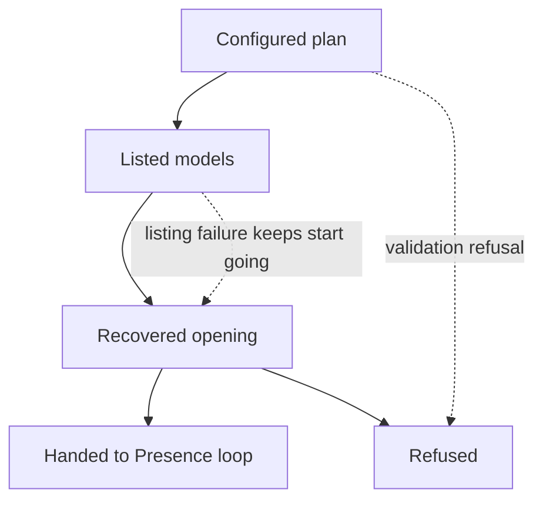
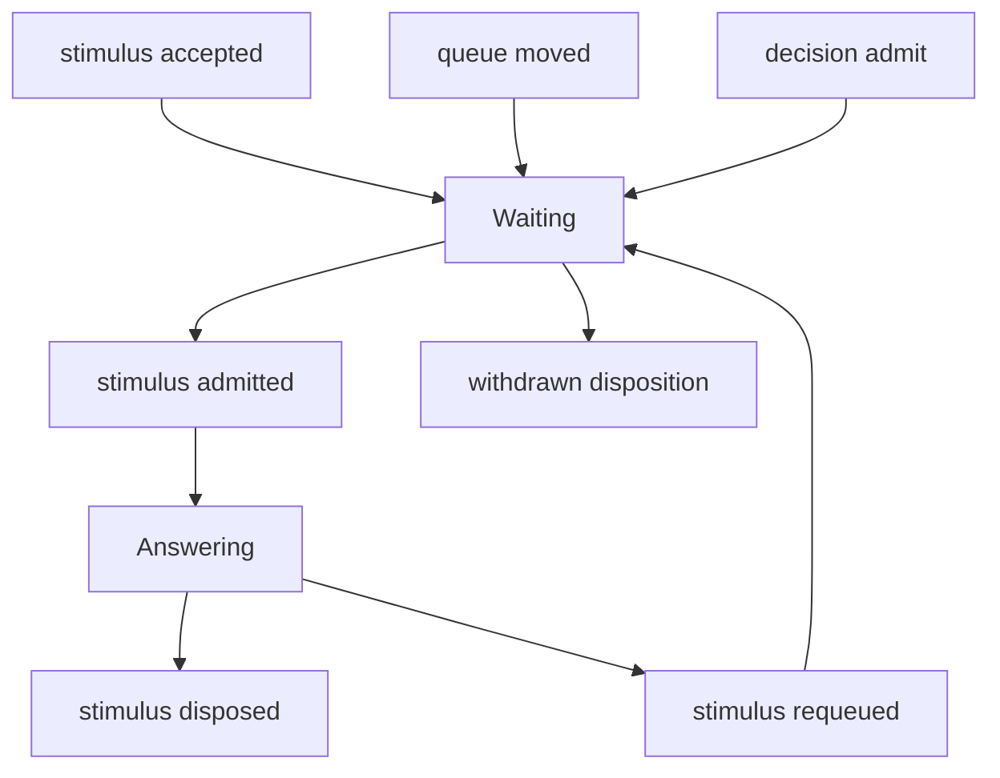
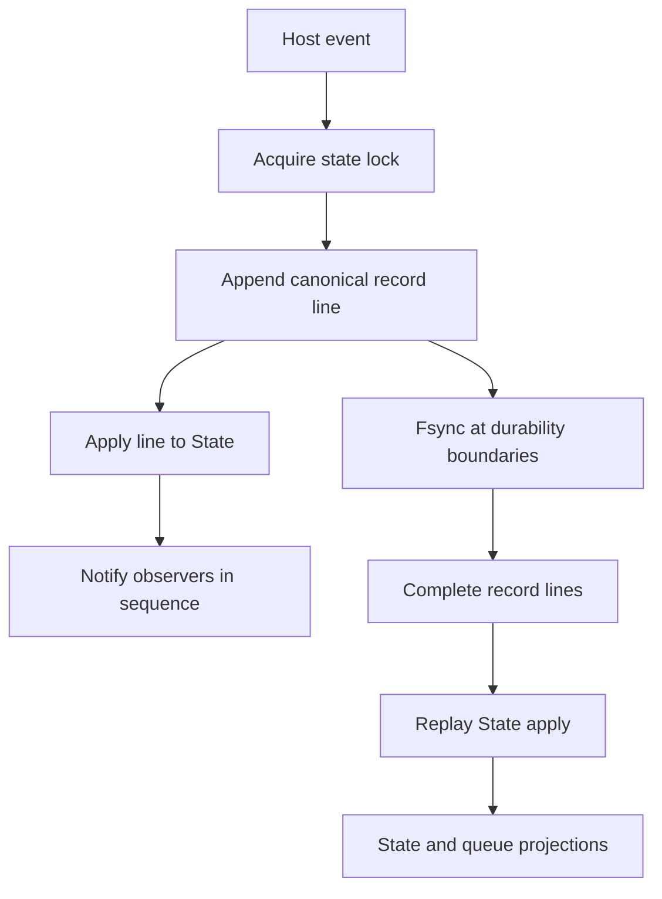

`rung-host` is the long-lived product host around one agent. Its lifecycle is deliberately record-first: the record is durable truth, while the in-memory state, queue views, registry summaries, and outward observers are projections. This page focuses on operating and safely changing that loop; see [Runtime Configuration, Credentials, and Local State](configuration-and-secrets.md) for broader configuration and secret-handling guidance, and [Host Gateway, Doors, and Observer UI](../integrations/gateway-and-ui.md) for the gateway and observer boundary.

## Start, validate, and hand off

The production entrypoint is:

```text
rung-host run --config rung-host.yaml
```

`run` constructs a typed startup ladder rather than opening state immediately. Configuration deserialization rejects unknown fields, validates options, resolves keys from the named environment variables, and builds the selected engine. Thus a configuration refusal exits before host state is opened. A real `agent` engine requires `engine.base_url` and `engine.api_key_env`; the latter names an environment variable and is not the key itself. `mock` is available for bounded local/test runs.



*The startup-handoff ladder validates first, lists before the record opens, then locks and recovers state before handing control to the loop.*

At the **Listed** stage, the router is queried before the record opens. Its initial availability verdict is later recorded at the first boundary as `ladder.listed` with `at_start`; failure to list does not prevent startup. At **Recovered**, the process acquires the per-state-directory lock before opening/replaying `record/`, and registration (when requested by `run`) occurs before other state is created. The lock remains held for the host lifetime, allowing at most one live host per state directory. A successful handoff runs the Presence loop; an opening/lock/registration failure is reported as a refusal.

A minimal real-host configuration makes the state location, endpoint, and variable name explicit:

```yaml
state: /var/lib/rung-host
engine:
  kind: agent
  base_url: https://openrouter.ai/api/v1
  api_key_env: RUNG_HOST_OPENROUTER_API_KEY
idle_time_s: 1800
```

Useful lifecycle settings include `idle_time_s`, `turn_bound_s`, `run_for_s`, `stop_file`, `inbox`, `quota`, `backoff_base_ms`, `ladder`, `listing`, and `probe`. With a config file, an omitted `idle_time_s` means 30 minutes; `idle_time_s: 0` explicitly selects continuous mode. A `HostConfig` created directly in code defaults to continuous unless it sets an idle duration.

## Boundary loop: continuous work versus deliberate rest

The loop starts by materializing startup/recovery lines and an epoch, then repeatedly advances a boundary. A boundary first honors a stop request and run limits, emits `boundary`, polls stimuli, fires calendar work and settlements, refreshes/probes the model ladder when due, and either rests, makes desk decisions, waits for the governor, or admits work and runs one bounded turn.

- **Continuous mode** (`idle_time_s: 0`) never performs an idle wait. After every turn it advances to the next boundary. Provider, quota, or pacing delays are not idle: they are world-imposed `degraded` waits.
- **Idle mode** (a positive duration; 30 minutes by default in file configuration) takes one free-time pass after a wake or queue drain, then rests only when no item is pending or in flight. It writes `idle`, fsyncs, and wakes at the earliest of its configured duration, a due calendar/expectation, the run limit, an arriving stimulus, or stop. During that rest it runs no boundary, turn, or model request; `idle.ended` names `scheduled`, `arrival`, or `stop` and leaves another free-time pass owed.
- A turn with admitted stimuli is a responding/draining turn. With no admitted item and no commitment, the kernel selects a free turn; a commitment selects a committed turn. The turn is bounded by the configured turn/tool and engine-step limits rather than becoming an unbounded agent session.

The decision desk supplies the admission, injection, tool, pack, and consolidation choices at a boundary. Its answer is constrained by hard rules and may fall back to rule behavior when the decider is unavailable, times out, is capped/killed, or is undecided. The governor runs after that selection and before admission, so it can postpone a request without falsely treating it as rest.

## Agent adapter and model availability

`AgentEngine` adapts the host's `TurnEngine` contract to `rung-agent-core::Engine` over an OpenAI-compatible route. The host—not the engine—owns the prompt thread and supplies the full stable tool superset plus its per-turn call gate. Calls use the ladder-selected model; the epoch supplies a sticky session ID on supported routes, and cache breakpoints mark the stable and slow prompt-layer ends. The adapter returns only messages it added; if the engine has to elide history after overflow, the turn records `rewritten: true` rather than concealing it. Each served call is recorded with usage, cache-token details, cost, route/provider label, and host-clock latency.

The configured ladder is ordered best-first. When listing is enabled, start and each successful refresh assess each rung for listing presence, non-expiry, zero prompt/completion pricing, `tools` support, and a usable endpoint. A failed refresh retains the previous verdicts and schedules a shorter retry rather than stopping the host. A keyed probe can additionally establish whether an otherwise standing model routes for the account; an account-policy refusal marks that rung unavailable until a later successful listing.

Failure classification matters operationally:

- Provider rate limits, overloads, transport failures, and timeouts produce capped jittered backoff and may step down to the next available rung. The departed rung cools down, then a later boundary may probe up to the nearest available cooled rung.
- A platform/account 429 identified by its rate-limit/reset signal waits for the reset but does **not** step down: changing models does not replenish the account quota.
- An authentication/configuration failure becomes `degraded: blocked`, probes on the blocked interval, and does not exit merely because credentials are unavailable. The owner is notified once per incident.
- Request quotas and pacing are separate governor waits. The daily quota reserves capacity for responding turns while spreading non-responding work across the UTC day. A paid-provider spend cap is the exceptional governor condition that halts the host.

While a wait is active, it is represented in the record as `degraded`/`degraded.ended`; it is not an `idle` interval. Stops poll through all waits. An owner item may wake only waits whose reserve policy allows it, and owner acknowledgement can be queued without a model call when the model cannot answer yet.

## Stimuli and queue lifecycle

A stimulus is accepted before its source is told it succeeded: the host atomically checks that its ID has not already been seen, appends `stimulus.accepted`, and fsyncs. External callers receive success only after that durability point. Owner stop/release controls are accepted and disposed as controls immediately; ordinary items remain pending for a boundary.

The queue is not an independently mutable database. It is a read-only fold of record events:



*Record events define the queue state: admission moves an item into the running turn, failure/restart can requeue it, and exactly one disposition completes it.*

A queue fold recognizes `waiting`, `answering`, `answered`, and `withdrawn`. `stimulus.admitted` moves pending IDs into the active turn; `stimulus.requeued` restores an interrupted/failed item to waiting; and `stimulus.disposed` settles it. The list puts answering work first, then waiting work, then completed work newest first. Among waiting entries, owner items sort ahead of other senders; owner `next`/`steer` precede owner `free`, and recorded `queue.moved` operations can reorder only within the relevant group. The latest `decision.admit` also explains whether an item is held for a break or digest.

Cancellation is race-aware: a waiting item can receive its durable `withdrawn` disposition; an already admitted item cannot be withdrawn as though it never ran. A client can retry submissions by ID because duplicate acceptance does not create another record line. The queue reader itself asks no running host and writes nothing, which is why stopped-host views can replay the same durable lifecycle.

## Record, projections, and restart recovery

The record consists of canonical, sorted-key NDJSON lines with monotonic sequence numbers and host-clock timestamps. It is segmented under `record/` and rotates after the configured segment size; segments are append-only and never rewritten/deleted during normal operation. A line is emitted in a strict order: append the line, apply it to state, then notify observers, all while holding the state lock. Conditional emissions and transactions evaluate their predicate and append/apply their lines under that same lock. Consequently, live state is always the projection of the durable prefix, not a competing source of truth.



*Live mutation is append-and-apply under one lock; restart and reader views rebuild projections by replaying the same complete record lines.*

The writer uses one write for an appended line/batch and fsyncs accepted stimuli, turn endings, wake/idle boundaries where required, and halts. On open, only bytes after the final newline of the newest segment are treated as a torn tail: they are truncated and counted. Earlier malformed complete data is not silently discarded. Replay then builds `State` by applying each line in order; the state hash is deterministic, and `turn.ended` records the pre-ending projection hash so recovery tests can compare reconstructed and live projections.

Some event kinds carry authority and cannot be emitted through the generic record API: `kernel.commit`, `kernel.release`, and `expectation.settled` are sealed. Their dedicated modules construct sealed entries, while generic append/batch calls reject those kinds. This prevents unrelated host paths from manufacturing a commitment, release, or settlement record.

On restart, recovery opens and replays the record, writes `recovered` with the gap/torn-tail information, requeues IDs admitted to a turn that never ended with `interrupted_by_restart`, ends any interrupted degraded wait, and starts a fresh epoch whose context records the gap. Kernel mode is reconstructed from record events rather than assumed. Calendar/expectation processing at subsequent boundaries handles work that became due while the process was down. This design makes an abrupt kill recoverable without claiming the interrupted turn completed.

## Stop, cancellation, and supervision

`StopAuthority` is the sole ordinary route to `Halted`. It accepts SIGTERM/SIGINT, a configured stop-file appearance, or an explicit owner/API request; the first reason wins. The loop checks it at every boundary, wait callbacks poll it, and a running turn receives a cancellation flag so the engine stops before another model call or tool operation. Halt emits and fsyncs `halted`, then signals shutdown to the notifier.

The loop emits readiness after wake initialization, liveness/watchdog notifications at boundaries and during waits, and stopping notification on halt. A supervisor can therefore restart a wedged process; recovery above is designed for precisely that abrupt lifecycle. Operationally, use a unique state directory per concurrent host and let the state lock prevent accidental dual writers.

## Verification focus

The host's gates are designed to be loopback-only rather than dependent on a live provider. Useful commands are:

```text
cargo test -p rung-host --locked
cargo test -p rung-host --test gate_engine --locked
cargo test -p rung-host --test queue_door --locked
cargo test -p rung-host --test soak_restarts --locked
```

`gate_engine` exercises the real adapter against a scripted OpenAI-compatible loopback provider, including host tools, request/session/cache metadata, served-call accounting, provider step-down, and platform-429 non-step-down behavior. `queue_door` verifies that a submission is recorded before its acknowledgement and tests queue door behavior over a spawned host. `soak_restarts` injects abrupt failures mid-accept and mid-turn over a simulated day, then checks that no stimulus is lost or duplicated, turn identities are not reused, and replay stays consistent.
