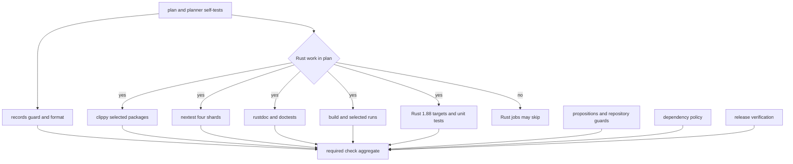

# Verification Strategy and CI Gates

Rung validates a change at the boundary it can break, rather than treating `cargo test` as a single proof. The layers are complementary:

- **compiler and UI-refusal proofs** protect declarations and type-level boundaries;
- **crate integration and property tests** exercise behavior through public APIs;
- **scripted provider, process, and protocol tests** test real adapters without a live model or credential;
- **contract tests** hold browser-facing HTTP/SSE behavior to a wire contract; and
- **generated-document and repository guards** validate the governing material and architectural constraints.

The workspace map in [Workspace Architecture and Ownership Boundaries](../architecture/workspace-boundaries.md) is the companion for deciding which crate owns a behavior. The agent and host flows documented in [Agent Turns and Sessions](../workflows/agent-turns-and-sessions.md) and [Continuous Host](../operations/continuous-host.md) identify the integration boundaries worth exercising.

## Pick the narrowest proof that can fail

Start locally with the smallest command that covers the changed boundary. For example:

```sh
cargo test -p rung --test spec_refusals --locked
cargo test -p rung-agent-core --test engine --locked
cargo test -p rung-host --test gate_engine --locked
cargo test -p rung-gateway --test gateway --locked
cargo test -p rung-memory --test properties --locked
python3 scripts/test_ci_plan.py
```

A narrow test speeds iteration and makes a failure legible; it is **not** a substitute for the CI gate. In particular, a local test neither selects reverse dependents nor runs formatting, strict linting, documentation, examples, MSRV compilation, dependency policy, generated-document checks, and release verification. Run an adjacent integration test when an API crosses crates, and add or alter the precise refusal/contract/property test when changing an invariant. Do not paper over a refusal snapshot change: the committed diagnostic is part of the promised behavior.

## Compile-time contracts: positive shapes and negative refusals

The `rung` suite uses ordinary compilation tests to prove emitted API shape, and `trybuild` UI cases to prove forbidden programs fail for the intended reason. `compile_pass.rs`, for example, coerces `Spec::carry` to its exact function-pointer type and checks generated rung and verdict types; it also checks that sealed rung/verdict tokens remain `!Send + !Sync`. These are useful when macro expansion or public generated signatures change.

`spec_refusals.rs` is a stronger negative layer than a `compile_fail` doctest. Rustdoc establishes only that its snippet did not compile; a typo can satisfy that condition. `trybuild` instead compares complete compiler stderr with the checked-in `.stderr` snapshot, so an error code or message drifting—or a case failing for a different reason—fails the suite. Representative cases reject external construction of a mid-ladder rung, dropping a `must_use` verdict, undeclared recovery/continue targets, malformed declaration rules, use-after-move of a consumed token, and a non-exhaustive outcome match. Regenerate snapshots only after deliberately reviewing the new diagnostic, conventionally with `TRYBUILD=overwrite`.

These tests make the type ladder’s refusal surface executable. For a runtime recovery path, pair them with a behavioral test: `end_to_end.rs` drives a ladder through recovery to a terminal verdict and demonstrates that a non-progressing recover body triggers the injected progress guard. Gate-marker tests similarly verify that a judgmental transition has a `Qualified<Role>` parameter minted by a pool rather than merely documenting that requirement. The conceptual rationale is described in [Type Ladders and Heteronomy](../concepts/type-ladders-and-heteronomy.md).

## Behavioral, property, and integration boundaries

Integration tests deliberately put fakes on the external side of a boundary while exercising the production implementation on the Rung side.

- **Agent engine:** `rung-agent-core/tests/engine.rs` sends scripted OpenAI-compatible replies through `Engine::turn`. It checks caller-owned thread continuity and event ordering, verifies that a disabled tool remains declared to the model but is refused and never executes, classifies provider failures (including retry timing), and verifies an MCP roster reconnects after its subprocess exits. This is the appropriate pattern for tool-gating, provider translation, and MCP lifecycle changes: use `rung-testkit`'s local mock, not a network model.
- **Agent process and ACP concurrency:** `rung-agent/tests/acp_concurrency.rs` starts the real `rung-agent` binary with either stdio ACP or HTTP ACP and holds a scripted response open. It demonstrates that cancel and close arrive during a turn, cancellation prevents a later LLM call, unrelated requests can be answered while a turn is running, and prompts for one session remain serialized. This catches protocol/process scheduling failures that a direct engine call cannot.
- **Het settlement law:** `rung-het/tests/gate_law.rs` uses a small theory and principals to test both sides of the gate. A decidable sentence settles without consulting a principal; a judgmental one records the qualified principal. Crucially, a judge sharing—even partially sharing—the material's provenance is refused, as is an empty-provenance model, while a capable disjoint principal is admitted. Negative cases are what prevent a nominal gate from becoming vacuous.
- **Memory properties:** `rung-memory/tests/properties.rs` supplies deliberately leaky stores across deterministic seeds. `walk` must return only the requested scope (or explicitly refuse an out-of-scope record), and budget cutting must preserve whole, ordered, unique records within limits. The same file checks that recency breaks equal-relevance ties but never outranks relevance. Use this style for invariants over many malformed backend responses, not just one hand-picked fixture.
- **Host resilience:** `rung-host/tests/gate_engine.rs` runs the real agent-core adapter against a loopback provider on a simulated clock, including tool refusal, truncated tool output, retry/rate-limit paths, and ladder switching. `soak_restarts.rs` goes wider: it injects provider faults and abrupt mid-turn/mid-accept failures through a simulated day, repeatedly restarts the host, then checks a gapless monotonic record, no reused turn numbers, no duplicate endings, and no lost or duplicated stimuli. It is the focused proof for persistence/replay and crash-recovery changes, not a default edit-loop command.
- **Gateway edge:** `rung-gateway/tests/gateway.rs` runs a gateway and stub host in-process. It tests proxy credential replacement and removal of client cookies, immediate SSE streaming rather than buffering, rejection of non-`/v1` or traversal paths, read-only authorization before a write reaches the host, and absence of instance keys from listings, errors, debug output, and responses. Changes at the security or proxy boundary should preserve these negative assertions.

## UI contracts are separate from Cargo CI

The browser UI is a non-Cargo deliverable. `ui/package.json` defines `typecheck`, `test`, `build`, and narrower contract scripts. The default Node test command runs the TypeScript test set; `test:contract` and `test:contract:queue` focus on the live-view and queue doors. Contract tests start a local target by default, but can point at a real gateway with `RUNG_CONTRACT_URL` and `RUNG_CONTRACT_INSTANCE`; real-target modes are explicit environment-selected commands.

The contracts are protocol tests, not screenshot checks. Representative assertions require typed summary fields, gapless record pagination, SSE replay ordered exactly like the record, `Last-Event-ID` taking precedence over `after`, and resume after a disconnected stream without duplicates or omissions. Queue tests require durable acceptance before an item is answered, idempotency for a repeated key, conflict for a reused key with different content, and malformed requests that write nothing. These contracts connect the UI to the gateway/host protocol described in [Gateway and UI](../integrations/gateway-and-ui.md).

At present, the Rust CI planner classifies `ui/*` as inert Rust input, and the workflow has no Node job. Therefore UI commands are required local/release discipline for UI changes but are **not currently included in the required `check` aggregate**. Do not infer from a green Rust PR plan that TypeScript typechecking, UI build, or UI contracts ran.

## CI is a planned aggregate, not one test command

The workflow begins with `plan`. For a pull request, `scripts/ci_plan.py` maps changed crate-owned files to seed crates and takes the reverse dependency closure (including normal, build, and development dependencies). It emits `SCOPE` as package flags. Known root-level test inputs map to their consumer crates; an unknown path and global build/CI inputs conservatively select the full workspace. Pushes to `master`, merge-queue runs, tags, and other non-PR events always select the full workspace. A change that is only an inert path has `rust=false`, so Rust jobs may be skipped intentionally.



This is the CI decision and aggregation flow. The `check` job accepts a skipped Rust test/docs/examples/MSRV job only when the planner said there was no Rust work; all other needed jobs must succeed.

The test job uses `cargo-nextest` over **four shards** with `--partition count:i/4`. Every shard compiles the selected test binaries and runs its round-robin share of individual tests; this deliberately distributes slow tests from a single binary rather than assigning whole binaries to a runner. `fail-fast: false` collects failures from all shards. Local `cargo test` is useful, but it does not reproduce this partitioned aggregate or prove every shard passed.

Always-on or independently required gates include:

- `cargo fmt --check`, skipped-test visibility checks, and `docs/_records_guard.py`, which permits edits under `docs/records/` only as dated append-only additions;
- `cargo clippy --all-targets --locked -- -D warnings` for planned Rust packages;
- rustdoc with `RUSTDOCFLAGS=-D warnings`, doctests, example builds, and selected offline/mock example runs;
- an MSRV (`1.88.0`) all-target check plus library/binary unit tests (UI snapshots intentionally run only on stable because compiler wording is pinned);
- `cargo deny check advisories licenses sources`, lockfile metadata validation, tag/version and publish-mark checks, and a release build of `rung-agent`.

The planning script has its own tests. When adding a root-level input to a test, doctest, or example, update its `EXTRA_INPUTS` rule; otherwise the planner treats an unrecognized path as full workspace for safety. Conversely, do not mislabel a Rust-affecting file as inert merely to make a PR faster.

## Generated governing documents and repository guards

Normative proposition and conformance documents are generated outputs. Edit their encoding in `rung-doctrine/src/`, then render with:

```sh
cargo run -p rung-doctrine --bin render
```

To verify without writing, run:

```sh
cargo run -q -p rung-doctrine --bin render -- --check
python3 docs/_props.py check
python3 docs/_props.py cited
```

**Do not manually edit generated `docs/*-props.md` documents or `docs/conformance.md`.** The renderer's `--check` compares checked-in output with the encoding. `_props.py check` independently recomputes proposition numbering and references and reports stale generated content; `_props.py cited` ensures proposition-shaped citations in designated Rust comments resolve. CI's `propositions` job runs those checks and the consumer guard, which rejects consumer-specific names in the generic kernel boundary. This makes documentation drift, invalid references, and a one-way-architecture violation build failures rather than review conventions.

## Safe change plan

1. Identify the owner and the observable invariant, then select the narrow test layer that can falsify it.
2. Add a negative refusal test for an API/compiler prohibition, an integration fake for an external boundary, or a deterministic property/soak assertion for a cross-input or durable-state invariant.
3. Run the focused local command and any directly affected neighbor crate; run UI scripts explicitly for UI changes.
4. If changing doctrine encoding, render it and run the render/check tooling—never hand-edit rendered proposition or conformance output.
5. Keep `scripts/ci_plan.py` rules aligned with new non-crate test inputs, and rely on the CI `check` aggregate to validate the planned scope, sharded tests, cross-cutting guards, and release-oriented gates.
