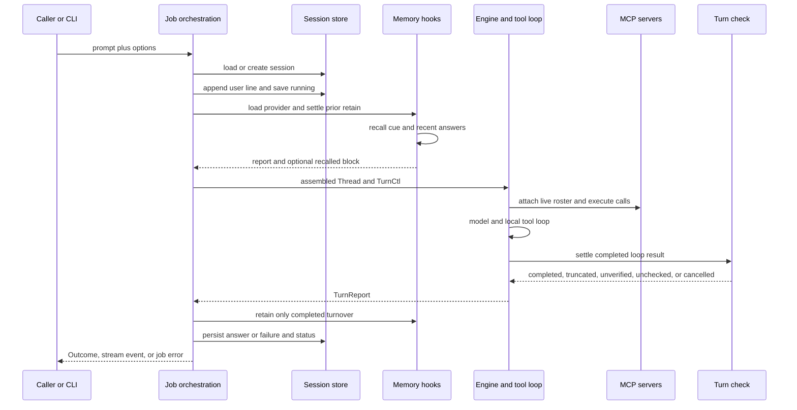

`rung-agent` is a headless, session-capable agent. Its CLI is one entrypoint; ACP callers can instead supply richer prompt blocks, cancellation, streaming listeners, tool observers, and session system text through the job API. The important boundary is between **job orchestration**, which owns process- and storage-facing work, and the reusable **Engine**, which runs a caller-assembled thread.

For memory-provider concepts and provider behavior, see [Memory Providers](../concepts/memory-providers.md). Configuration and credential precedence are covered in [Configuration and Secrets](../operations/configuration-and-secrets.md); MCP and ACP integration details are in [ACP, MCP, and OAuth](../integrations/acp-mcp-and-oauth.md).

## Entrypoints and configuration resolution

The normal executable parses `Args`, accepts a positional prompt or reads non-terminal stdin when neither a prompt nor task ID was supplied, captures the original cwd, and calls `run_job`. `--task-id ID` without a prompt is a poll rather than a new model turn. `--acp` and `--acp-http` dispatch to the ACP service instead; `--json` emits one serialized `Outcome`, while `--stream` emits the final result through the NDJSON stream emitter. Missing or invalid CLI input is a usage error (exit 2); a job error is reported to stderr with exit 1.

A job resolves model configuration from `RUNG_CONFIG` or the XDG config file, with environment values overriding file values. It separately resolves tool groups, the turn-check backend, image forwarding, and memory settings. Tool selection is deliberately capability-based: `--tools` takes precedence, then configured `tools:`, then the selected preset. The `explore` and `review` presets are read-oriented; `implement` adds write, shell, todo, and nested-task capability. A preset supplies a default model-call cap (16 for explore/review and 32 for implement); `--max-iterations 0` removes that cap.

System text is assembled outside the engine. `--system-prompt` (literal text or `@file`) wins over `RUNG_SYSTEM_PROMPT_FILE`; a caller-provided session system prompt is appended and retained on the session so a resume can reproduce it. A caller may also supply user material that becomes the first user message before the session history.

## Ownership model: orchestration versus `Engine`

`EngineSpec` is a value-only description of model configuration, scope, cap, turn checking, images, MCP specifications, and workspace. `Engine::turn(thread, TurnCtl)` reads neither environment nor config and takes no session-store action. It also never changes the process cwd. It runs the supplied `Thread`, attaches tools and per-turn controls, then settles the result through the turn-check gate. Tools themselves continue to resolve relative paths against the process cwd.

`run_job_ex` is the complementary orchestration layer. It chooses the session ID and store, loads or creates the session, appends the user line, optionally creates and enters an isolation worktree, marks the session `running`, resolves configuration and memory hooks, assembles the thread, invokes the engine, and persists the resulting answer or failure. A cwd guard restores the originating cwd after a worktree run. This split lets an embedding host retain ownership of thread construction and persistence while sharing the agent/tool loop.

## Request lifecycle

*The orchestration path owns recall, persistence, and cwd; the engine owns one bounded loop and its verification step.*

### Session replay and persistence

A `Session` records identity, selected kind, status, original cwd, optional isolation path and PID, optional session system text, and ordered `Line` records. A user line stores the user text and, if recall succeeded, the separate recalled block. An answered assistant line stores both final text and the full messages the loop added—tool use, results, and answer—so future turns replay the actual transcript rather than an abbreviated narrative. Tool images are replaced by an explanatory note because the session file does not retain image data.

Session files live under `<origin>/.rung/sessions`. The current representation is an fsynced append-only JSONL event log; legacy whole-file JSON remains readable. Save takes an exclusive advisory lock, detects a writer that advanced the log since this writer's witness, and refuses to overwrite unseen concurrent updates. It tolerates a torn final append by replaying valid complete records and truncating that final fragment before continuing.

Failed turns are intentionally distinct from answered turns. Except for overflow, orchestration saves an assistant failure line with an empty display text, the transcript steps that actually ran, and a non-replayed failure reason. On a later turn the steps replay but the failure prose does not. An overflow discards its pending user ask and all of that turn's history, preventing the oversized request from being resent.

Background submission persists `queued`, launches a child, then records `running` and its PID, returning an `Outcome` with `running` immediately. A poll returns `Status::Recorded` from stored status rather than judging the session again; if a recorded running PID is no longer alive, it is changed to `interrupted`.

## Thread, tools, and MCP

The orchestrator converts session lines to a `Thread`: user lines (with recalled material when present), persisted assistant message sequences, and fixed summary pairs are replayed in order. The engine executes at most the configured number of model calls with a roster derived from its `Scope`. It can add a workspace-local Python sandbox, an optional nested `task` tool, memory-provider tools, MCP tools, and observer wrappers. Provider tools are layered without shadowing built-in tool names; MCP sits over that combined set.

`TurnCtl` provides per-turn cancellation, streaming, diagnostics sink, tool wrappers, request/prior actions for verification, and optional model or provider session-ID overrides. A disabled tool remains declared—preserving a stable tool definition/prefix—but execution is refused without calling it. With a stream listener, the engine records provider-served model and usage per call and forwards stream events to the caller.

MCP supports HTTP and spawned stdio server specifications. Engine construction connects servers, performs initialization and tool discovery, and holds the roster across turns. If any server has died before a later turn, the engine attempts to reconnect and replaces/aborts the old roster; failure is emitted as a diagnostic and the current roster is still used. Duplicate remote tool names are disambiguated using the server name. MCP calls and cancellation are attached for the current turn.

The `task` capability runs a depth-capped child agent with its own persisted child session. Its completion goes through the same settlement logic, so a child cannot claim `completed` merely because its model stopped when checking is enabled.

## Turn checking and status semantics

A normal loop result is not automatically a verified completion. `Status::Completed` carries an unforgeable `Completion`: it is created either because checking is switched off or because the check passed. The switch is `turn_check.backend` / `RUNG_TURN_CHECK`, defaulting to `off`; `jev` uses its configured endpoint, model, key environment variable, and timeout.

When enabled, the checker builds a redacted but untrimmed account of the request, this turn's tool calls and results, prior-turn action names, and final message. A judge can pass a supported done/answered/asked-user/blocked reading, flag it unverified, or be unavailable. A narration reading can trigger exactly one rerun with `NUDGE`, which tells the model to perform the claimed action or say plainly it was not done. The rerun is checked once more; a turn is never nudged twice.

| Result | Meaning and persistence behavior |
| --- | --- |
| `completed` | The check passed, or checking was off. Only this status is eligible for memory retention. |
| `truncated` | The provider finished due to the length limit. It is not checked or completed. |
| `unverified` | A judge read the turn but did not pass it, including narration after its one nudge. The model text is retained for the host to handle. |
| `unchecked` | The check was enabled but has no valid reading—for example missing key, unreachable/rate-limited judge, malformed response, or state exceeding the judge window. The answer is delivered unchanged but is never completed. |
| `cancelled` | Cancellation/interruption stopped the loop or a nudge rerun. The session persists as `interrupted`. |
| provider failure | A model-loop failure other than interruption is a `JobError`, session status `error`, and a recorded failure line. `TurnReport.failure` exposes typed provider classification such as authentication or rate limiting and retry delay. |
| `running` / recorded status | `running` represents a background launch; a poll returns the persisted status as `Recorded`, not a fresh verdict. |

Truncation wins before checking. If the nudge rerun itself is truncated, the outcome is `truncated`. If it fails, interruption becomes `cancelled`; another failure becomes `unverified` with the original answer and captured rerun steps. These distinctions matter to callers: process success for an `Outcome` does not mean verified completion—inspect `status` and, where present, `turn_check`.

## Memory hooks

Memory is an orchestration hook rather than an engine concern. Authority precedence is `--memory`, then `RUNG_MEMORY`, then `memory.provider`, then `off`. `external` means the caller owns memory: no provider is opened, no recall/retain hook runs, and no provider tools are injected. Provider mode supports baseline storage, MCP providers, and registered providers.

Before the loop, the job waits briefly for pending retains in the same scope, then recalls using a redacted prompt and prior successful assistant answers. Found evidence is rendered as quoted data **after** the current user message, never as system text; the exact block is stored in `Line.recalled` for byte-stable replay. Provider tools, when advertised, are admitted to the roster for the session scope.

After an answered turn, retain is offered only for `Status::Completed`. The turnover includes redacted whole request and answer plus session/line/source/check metadata. Retain is asynchronous and initially reported as `deferred`; `RUNG_MEMORY_RETAIN=distill` opt-in can reduce it to durable conclusion material. A provider unavailable during construction becomes a down provider, and recall/retain failure is reported through `Outcome.memory` and diagnostics rather than failing the agent turn. Thus a nonfatal memory failure must not be interpreted as a provider/model failure. The CLI waits for all pending retains before it exits.

Unless `memory.scope` is configured, the scope is an opaque hash of the Git `origin` URL, or canonical repository root fallback. This avoids revealing the path and allows a worktree and its main checkout to share memory; default baseline data is under the repository `.rung/memory`.

## Operational guidance and test anchors

- Treat the origin cwd as the storage anchor. Session files are rooted at the original cwd even when `--isolation worktree` changes the cwd for tool execution.
- If a host embeds `Engine`, construct the full desired thread and persist its returned transcript itself. The engine does not compact or alter caller-provided history.
- Configure a turn check when `completed` must represent independently checked work; otherwise completion means the compatibility mode where checking was off.
- Surface `Outcome.memory` separately from job failures. It provides provider, recall, and retain reports precisely because memory degradation is nonfatal.
- For a provider failure, consume the `TurnReport` rather than inferring a cause from human-readable error text; it carries typed authentication/rate-limit information.

Focused tests document these contracts: `rung-agent-core/tests/engine.rs` verifies no session writes from `Engine::turn`, tool gating, typed provider failures, streamed call accounting, and MCP reconnection. `rung-agent-core/tests/engine_thread.rs` verifies that the caller-owned thread is preserved byte-for-byte. `rung-agent/tests/cli.rs` covers polling, background error persistence, and iteration-cap behavior. `rung-agent/tests/turn_check.rs` exercises narration-to-nudge-to-action, unverified results, and unavailable or malformed judge outcomes. See [Verification and CI](../testing/verification-and-ci.md) for broader test guidance.
